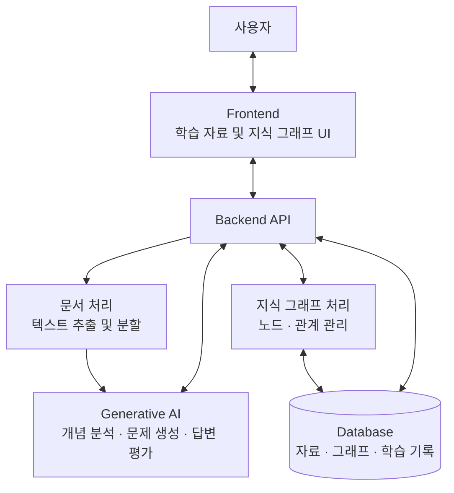
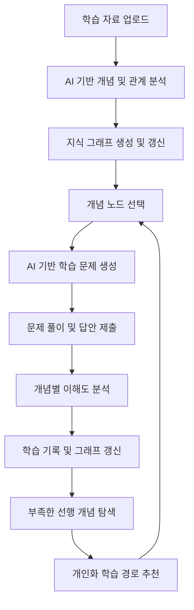

# LearnMap

웹 분석은 기본적으로 `AI_DETAIL_MODE=on-demand`를 사용합니다. 개념·세부 학습 항목·원문 근거와 관계를 먼저 분석하고, 전체 상세 설명 생성은 그래프 공개를 지연시키지 않습니다. 개념 상세 페이지의 ‘상세 설명 작성’으로 해당 개념만 생성하며, 검증에 성공한 설명은 저장되고 실패하면 기존 결과를 유지합니다. 아직 생성하지 않은 설명은 `detailsState: "pending"`으로 구분하고 학습 본문으로 표시하지 않습니다. `AI_DETAIL_MODE=eager`로 설정하면 이전처럼 모든 설명을 생성한 뒤 그래프를 공개합니다. CLI는 전체 설명을 생성하는 기존 동작을 유지합니다.

자료 추가·재분석 시 파일 간 관계는 변경된 자료의 근거가 포함된 개념과 다른 파일의 개념을 비교합니다. 변경되지 않은 파일 사이의 관계는 유지하고, 변경된 개념에 연결된 기존 파일 간 관계는 다시 검증합니다. 파일 간 후보는 코드가 핵심 용어의 희소도와 원문 상호 언급으로 먼저 검색하고, 빠른 모델(`relation_candidates`)은 개념 목록을 크게 묶어 표현이 다른 후보를 보완합니다. 전체 조합을 하나씩 모델에 열거하지 않습니다. 두 후보 목록을 합쳐 작은 자료 쪽의 개념별로 파일 쌍마다 상위 6개 후보를 고추론 모델(`relation_adjudication`)이 판정합니다. 원문에 명시된 상하 관계와 원문에서 다른 개념을 언급하는 쌍도 보완 후보로 사용합니다. 후보 선별로 중요한 관계가 누락될 수 있으므로 모든 관계의 발견을 보장하지 않습니다. 문항 품질 재생성은 최대 3회이며, 계속 실패하면 오류를 반환합니다. Ollama 요청 로그의 `usage`에는 제공되는 경우 `loadMs`, `promptEvalMs`, `evalMs`, `totalMs`도 기록합니다.

검증된 후보 탐색·정밀 판정 묶음과 완료된 분석 단계는 저장 파일 옆의 `workspace.json.checkpoints/`에 입력·모델·프롬프트 기준으로 저장됩니다. 실패 또는 서버 재시작 후 재실행하면 완료 묶음을 다시 호출하지 않습니다. 저장된 응답도 현재 스키마와 개념 쌍·근거로 재검증하며, 실패·미완료 결과는 완료 단계로 저장하지 않습니다. `AI_ANALYSIS_CACHE=0`이면 이 재사용도 끕니다. 개념 정리는 1회 순회로 수행하고 이름과 설명이 모두 같은 항목만 코드로 합치며 원래 학습 항목·근거·멤버 ID는 보존합니다. 관계 요청은 learnmap-cloud에서 파일당 기본 16개, 일반 클라우드는 4개 병렬, Ollama는 1개이며 `AI_RELATION_CONCURRENCY`로 조절합니다. 기존 `AI_CONCURRENCY`를 명시한 경우 그 값이 기본값보다 우선합니다.

AI 실행 로그는 실행 위치의 `./logs/ai-YYYY-MM-DD.jsonl`에 런타임 동안 즉시 추가됩니다. 날짜와 타임스탬프는 UTC 기준이며, 요청 시작·완료·실패·재시도, 공급자·모델, 토큰 사용량, 분석 진행 상황과 단계별 소요 시간을 기록합니다. API 키, 프롬프트, 학습 자료 본문과 모델 응답 본문은 기록하지 않습니다. `logs/`는 Git에서 제외됩니다.

AI가 생성하는 개념명·설명·문제·채점 피드백·학습 경로는 원문 언어와 관계없이 한국어로 출력하도록 공통 지침을 적용합니다. 출력 전에 [언어 감지와 한국어 번안](docs/korean-localization.md)을 수행하고, 번안 실패 시 원래 결과와 안내를 제공합니다. JSON 키와 enum, ID, 원문 인용은 그대로 유지합니다. [분석 결과 JSON 구조와 분석 시간 단축 설계](docs/ANALYSIS.md)를 참고하세요.

파일 간 관계 분석은 원문 근거를 공유 목록으로 묶어 중복 전송을 줄입니다. 개념별로 최대 두 구절(각 450자)을 관련 개념의 언급 주변에서 선택하며, 고추론 모델이 관계 유형·방향·근거 ID를 함께 판정합니다. 원문에서 실제로 가져온 구절인지, 지정된 두 개념과 그 근거만 사용했는지, 누락·중복 판정과 순환이 없는지 코드로 검사합니다. 파일 간 단계는 270초의 처리 예산과 최대 48개의 고추론 판정 호출을 사용하며(전송 재시도 제외), 각 호출의 일시적인 503·연결 오류 등은 최대 한 번 재시도하며, 재시도와 대기도 같은 시간 예산을 따릅니다. 한도에 도달하면 검증된 결과만 저장하고 자료 관리 화면에 미완료 경고를 표시합니다. 미완료 결과는 분석 캐시에 완성본으로 저장하지 않습니다. 이 제한은 PDF 전체 분석 시간이 아닌 파일 간 연결 단계에 적용됩니다.

파일 내부 관계 분석은 대표 인용 외에 관련 원문 근거를 함께 사용합니다. 원문에 명시된 분류 문장은 방향을 확인하고, 나머지 상하·선수 관계는 별도 검토에서 상위·하위 또는 선수·후속 개념 ID와 근거를 지정하게 합니다. 근거 없는 관계, 설명과 방향이 모순되는 관계, 순환 관계는 저장하지 않습니다. 검토는 추가 모델 요청이므로 분석 시간이 늘 수 있으며, 의미적 정확성을 보장하지는 않습니다. 기존 자료는 서버 재시작 후 재분석해야 적용됩니다.

## 운영용 API와 MySQL

운영용 API는 Fastify와 Prisma로 MySQL에 접속합니다. 프런트엔드는 별도 호스트에서 Vite 빌드 결과를 서비스하고, 같은 HTTPS 주소의 `/api/*` 요청을 백엔드 VM으로 역방향 프록시합니다. 이 구성에서 쿠키는 프런트엔드의 공개 주소에 설정되고 브라우저의 CORS 설정은 필요하지 않습니다. 예시 설정은 [프런트엔드 nginx 설정](deploy/frontend-nginx.conf.example)에 있습니다. 정적 호스팅을 사용한다면 동일한 경로를 VM으로 보내는 HTTPS 프록시나 rewrite를 설정합니다.

1. VM의 MySQL 8.0 이상에 LearnMap 전용 데이터베이스와 계정을 만듭니다. VM에서 설치 방식에 따라 `sudo mysql` 또는 `mysql -u root -p`로 관리자 콘솔을 연 뒤, 아래 SQL의 비밀번호를 바꿔 실행합니다.

   ```sql
   CREATE DATABASE learnmap CHARACTER SET utf8mb4 COLLATE utf8mb4_unicode_ci;
   CREATE USER 'learnmap'@'127.0.0.1' IDENTIFIED BY '<새로운 DB 비밀번호>';
   GRANT ALL PRIVILEGES ON learnmap.* TO 'learnmap'@'127.0.0.1';
   ```

2. 백엔드 VM에서 `npm ci`, `npm run db:generate`, `npm run db:migrate`를 실행합니다. 마이그레이션 전에 VM 환경 또는 백엔드 전용 `.env`에 `DATABASE_URL="mysql://learnmap:<URL로 인코딩한 비밀번호>@127.0.0.1:3306/learnmap"`을 설정합니다. MySQL 포트는 VM 내부에서만 사용합니다.
3. VM의 `APP_ORIGIN`은 공개 프런트엔드 주소(예를 들어 `https://learnmap.example.com`), `API_HOST`는 VM의 사설 IP 또는 `0.0.0.0`, `API_PORT`는 기본 8787로 설정하고 `npm run start:api`를 실행합니다. API 포트는 프런트엔드 프록시의 접속만 허용합니다. `API_TRUST_PROXY`에 프록시 IP를 설정하면 프록시가 덮어쓴 클라이언트 IP를 로그인 요청 제한에 사용합니다. VM에서 `GET /healthz`로 상태를 확인합니다.
4. 프런트엔드 배포 환경에서 `npm ci`, `npm run build:web` 실행 후 `apps/web/dist`를 서비스합니다. React 경로는 `index.html`로 연결하고, 프록시는 원래 공개 Host와 Origin을 전달해야 합니다. `DATABASE_URL`과 AI 비밀값은 VM에만 둡니다.

개발 중에는 기존 `npm start`를 실행하면 로컬 JSON 저장소를 사용할 수 있습니다. MySQL 연결을 개발 환경에서 확인하려면 `APP_ORIGIN`을 비우고 로컬에서 `npm run start:api`와 `npm run dev:web`을 각각 실행합니다. API 포트를 변경했다면 프런트엔드 개발 서버에도 같은 `API_PORT`를 설정합니다.

이전에 생성된 PostgreSQL DB와 그 마이그레이션은 MySQL에 자동으로 이전되지 않습니다. 기존 JSON 데이터는 운영 API를 시작하기 전에 `npm run db:import -- --file <기존 workspace.json 경로>`로 빈 MySQL에 이전할 수 있습니다. 파일과 계정, 자료·과목 ID, 학습 기록, 세션 해시를 보존합니다. 브라우저 쿠키가 보존된 경우 기존 식별자를 계속 사용할 수 있습니다. 공개 주소가 바뀌면 기존 호스트에 저장된 브라우저 쿠키는 새 주소로 전달되지 않습니다. 소유자가 없는 기존 지도는 로컬 복구 화면으로 먼저 가져오거나, 가져오기 명령의 `--legacy-owner <원본에 존재하는 계정 이메일>`로 소유자를 명시할 수 있습니다.

현재 운영 구성은 **API 한 프로세스**를 기준으로 합니다. 계정·세션·학습 공간·과목·분석을 MySQL에서 별도 테이블로 저장합니다. 기존 그래프와 학습 기록의 구조는 JSON, 업로드 원본은 LONGBLOB로 보존합니다. 로그인 시 공간 소유권과 세션을 하나의 트랜잭션으로 갱신합니다. 분석 실행은 현재 API 프로세스의 기존 처리 흐름을 사용합니다.

## 계정과 기기 동기화

로그인 없이 지도 생성과 학습 기능을 사용할 수 있습니다. 상단의 **로그인**에서 이메일과 10~128자 비밀번호로 가입하거나 로그인합니다. 로그인 시 이 브라우저의 비로그인 과목, 분석 중인 자료, 지도, 문제와 학습 기록을 계정에 자동으로 이전합니다. 계정의 기존 과목을 덮어쓰지 않으며, 다시 로그인해도 중복으로 가져오지 않습니다. 이름이 같은 서로 다른 과목은 별도로 유지됩니다. 로그아웃 후에는 비어 있는 비로그인 공간으로 돌아가며 계정 자료는 계정에 남습니다.

브라우저에는 비로그인 공간을 식별하는 HttpOnly 쿠키(1년)와 로그인 세션 쿠키(30일)를 보관합니다. 지도 및 원본 자료의 실제 저장 위치는 로컬 데모에서는 `.learnmap/workspace.json`, 운영용 API에서는 MySQL입니다. 비밀번호는 무작위 salt를 적용한 scrypt 해시, 세션 토큰은 SHA-256 해시로 저장하며 모든 자료 API에서 소유자를 검사합니다. 쿠키를 지우기 전에 로그인하면 비로그인 자료를 계정으로 보존할 수 있습니다. 로그인·로그아웃 시 다른 탭도 새로고침하며, 기기 간 변경 사항은 페이지 재방문 또는 창으로 돌아올 때 갱신합니다. 오프라인 사용은 지원하지 않습니다.

계정 도입 전 저장소에는 소유자가 없습니다. 로컬 전용 모드에서는 홈의 **저장된 학습 공간 열기**로 소유자가 없던 기존 과목·자료·학습 기록을 로그인 없이 다시 불러올 수 있습니다. 로그인 시에도 브라우저의 기존 `learnmap.subjectId`에 해당하는 과목과 소속 자료만 복구합니다. 나머지 기존 자료는 파일에 그대로 남으며 임의 계정에 일괄 배정하지 않습니다. 공개 배포에서는 이 복구 경로를 비활성화합니다.

여러 기기에서 이용하려면 **같은 서버**에 접속해야 합니다. 현재 서버는 기본적으로 `127.0.0.1`에 바인딩됩니다. 공개 서비스에서는 HTTPS 리버스 프록시를 이 서버로 연결하고 `.env`의 `APP_ORIGIN=https://실제도메인`을 설정하세요. 설정된 Host/Origin만 추가로 허용하며 인증 쿠키에 Secure를 적용합니다. 로컬 데모와 운영용 API 모두 서버 프로세스 하나를 기준으로 합니다. 이메일 소유 확인과 비밀번호 재설정은 포함하지 않습니다.

## React 프런트엔드와 라우팅

웹 UI는 `apps/web/src`의 React + TypeScript 애플리케이션입니다. Vite로 빌드하고 React Router의 BrowserRouter로 페이지를 전환합니다. 서버 데이터는 TanStack Query로 조회·갱신·분석 상태 폴링을 관리하며, API 응답은 Zod로 검증합니다. 기존 SVG 그래프 엔진과 백엔드 AI/API는 재사용합니다.

- `app/`: 라우터, 과목 공통 레이아웃, 첫 진입 페이지
- `features/`: 자료 관리, 그래프, 개념 상세, 문제 풀이, 학습 경로, 학습 기록의 페이지 컴포넌트
- `components/`, `hooks/`, `utils/`: 공통 UI, 컨텍스트·조회 갱신 훅, API 검증 및 URL 함수

페이지 주소는 `/subjects/:subjectId/graph`, `/materials`, `/concepts/:conceptId`, `/concepts/:conceptId/quiz`, `/learning-path`, `/history` 형식입니다. 뒤의 경로도 모두 `/subjects/:subjectId` 아래에 위치합니다. 그래프 선택 개념·검색·필터는 쿼리 문자열에 보관합니다. 서버는 UI 경로의 직접 접속과 새로고침에 빌드된 HTML을 반환하고, 없는 과목·개념은 오류 페이지를 표시합니다. 현재 탭의 문제 묶음·답안·평가 결과는 sessionStorage에 보관하므로 페이지 이동과 새로고침 후 이어서 풀 수 있습니다. 서버가 해당 문항을 폐기했다면 새 문제를 생성해야 합니다.

```powershell
npm install
npm start          # React 빌드 후 API와 웹 UI 실행: http://127.0.0.1:8787
npm run dev        # API + Vite 개발 서버 실행: http://127.0.0.1:5173
npm run typecheck  # API 및 React TypeScript 검사
npm test           # 빌드 + 기존 단위·통합 테스트
npx playwright install chromium # 브라우저 테스트 최초 준비
npm run test:e2e   # 빌드 + 독립 fixture 서버에서 브라우저 통합 테스트
npm run format:check
```

개발 서버는 API 요청을 로컬 백엔드로 프록시합니다. `DEMO_PORT`로 API 포트를 바꿀 수 있으며 Vite 포트는 5173입니다. `npm run dev` 전에 같은 API 포트에서 실행 중인 기존 서버를 종료하세요. 기존 단독 JSON 데모는 백엔드의 `/demo`에 유지합니다. 브라우저 테스트는 실제 AI와 `.learnmap/workspace.json`을 사용하지 않습니다.

## 웹사이트 실행

큰 AI 입력은 지침과 응답 스키마까지 포함한 요청 예산에 따라 분할합니다. 답안 점수는 한 번 확정하고 연결 개념을 나누어 추가 분석하며, 경로는 전체 선수 순서를 검증한 뒤 구간별 설명을 합칩니다. 추가 설명 일부가 실패해도 완료된 채점과 검증된 결과를 보존하고 미완료 부분을 표시합니다. 자세한 동작과 검증 한계는 [분할 처리 설계](docs/partitioning.md)를 참고하세요.

Node.js 24 이상에서 `npm install` 후 `.env.example`을 참고해 `.env`에 AI 공급자와 모델을 설정하고 실행합니다.

OpenAI와 Gemini도 `OPENAI_MODEL` / `OPENAI_FAST_MODEL`, `GEMINI_MODEL` / `GEMINI_FAST_MODEL`로 작업별 모델을 분리할 수 있습니다. 관계 분석·관계 판정·관계 검증만 기본 모델을 사용하고, 개념 추출·상세 설명 작성·개념 정리·문제 생성·객관식 검토·채점·학습 경로·근거 요약·한국어 보정은 Fast 모델을 사용합니다. 모델 선택을 작업별로 분기하며, OpenAI와 Gemini의 추론 강도 옵션을 별도로 지정하지는 않습니다. Fast 모델은 각 제공자의 구조화된 JSON 출력을 지원하는 모델로 설정하세요. Fast 모델 값을 비우면 모든 작업에 기본 모델을 사용합니다.

Ollama에서는 `OLLAMA_MODEL=deepseek-r1:14b`, `OLLAMA_FAST_MODEL=qwen2.5:7b`처럼 작업별 모델을 분리할 수 있습니다. 관계 분석·관계 판정·관계 검증만 `OLLAMA_MODEL`을 사용하고, 개념 추출·상세 설명 작성·개념 정리·문제 생성·객관식 검토·채점·학습 경로·근거 요약·한국어 보정은 `OLLAMA_FAST_MODEL`을 사용하며 추론을 끕니다(`think: false`). 두 모델 모두 Ollama에 설치되어 있어야 합니다. `OLLAMA_FAST_MODEL`을 비우면 기존처럼 모든 작업이 `OLLAMA_MODEL`을 사용합니다. 요청 진단 이벤트의 `model`로 실제 사용 모델을 확인할 수 있습니다. `.env` 변경은 서버를 재시작하면 적용됩니다. 작은 모델의 문제·채점 품질과 한국어 출력은 실제 학습 자료로 확인하세요.

```powershell
npm start
```

[LearnMap 열기](http://127.0.0.1:8787)에서 과목을 만들고 PDF·TXT·Markdown 자료를 추가할 수 있습니다. Figma의 지식 그래프, 개인화 학습 경로, 문제 풀이 디자인을 React 기능별 페이지와 기존 외부 CSS로 구현했습니다. React Router, TanStack Query, Zod와 Vite를 사용합니다.

- **자료 관리:** 과목별 업로드, 진행 상태 및 자동 재연결, 원본 보기, 삭제, 재분석을 지원합니다. 재분석 실패 시 이전의 성공한 그래프를 복구합니다.
- **지식 그래프:** 개념 선택, 설명 및 선수 개념, 원본 페이지 연결, 검색 및 이해도 필터, 이동·확대·축소를 지원합니다. 개념 노드와 과목 노드를 드래그해 배치를 바꾸면 연결선이 실시간으로 따라갑니다. 빈 공간을 드래그하면 지도 전체가 이동합니다. 배치는 현재 탭에서 과목별로 유지되며 검색·필터·이해도 갱신 후에도 보존됩니다. 페이지를 새로고침하면 초기 배치로 돌아갑니다. 키보드로 노드를 선택할 수 있으며, 노드에 초점을 맞추고 `Shift`+방향키로 노드를 움직일 수 있습니다. 방향키는 지도 이동, `+`·`-`는 확대·축소, `0`은 이동한 노드를 포함한 전체 보기에 사용합니다.
- **개념 상세:** 사이드바에는 짧은 요약을 표시하고, 개념 상세 페이지에서 세부 학습 항목과 원문 근거를 확인합니다. 상세 설명은 기본적으로 ‘상세 설명 작성’을 눌렀을 때 생성합니다. 핵심 개념으로 묶어도 원래 세부 내용은 보존합니다. 설명의 분량은 주제에 맞추되, 학습 예고문·임시 문구·반복 문장과 문단을 검출하면 교정 사유와 함께 최대 2회 다시 작성합니다. 내용 검증이 계속 실패하면 기존 설명을 덮어쓰지 않습니다. 형식 오류로 기존 설명을 유지할 때도 동일한 내용 검증을 적용합니다. 이 검증은 사실성 전체를 보장하는 평가가 아니므로 실제 자료를 통한 품질 확인이 필요합니다.
- **학습:** 객관식·단답형·서술형 문제와 난이도를 선택할 수 있습니다. 세부 학습 항목과 원문 분량에 따라 문제 수가 자동으로 달라지며, 긴 항목은 나눠 출제합니다. 생성된 문제를 차례로 풀며 정답률과 완료 범위를 확인합니다. 서술형은 부분 점수를 반영합니다. 새 묶음의 첫 답안을 제출하면 현재 묶음 전체를 기준으로 이해도를 재평가하며, 미풀이 문제는 임시로 0점에 포함합니다. 전체 문제를 완료하고 평균 80점 이상이면 이해 완료, 50점 이상이면 복습 필요, 나머지는 이해 부족입니다. 과거 풀이 이력은 보존하고, 이전 방식의 기록만 있는 개념은 기존 최근 5회 평균을 유지합니다. 문제 생성에 실패해도 기존 이해도는 유지합니다. 범위가 넓으면 생성 시간과 AI 요청 수가 늘어납니다.
- **저장:** 원본 자료, 분석, 문제, 학습 기록과 경로를 `.learnmap/workspace.json`에 저장하고 서버 재시작 후 복구합니다. 이 폴더는 Git에서 제외합니다. 서로 다른 서버 프로세스가 같은 저장 파일을 동시에 사용하지 않도록 하세요.

기본 데모는 **이 컴퓨터에서 사용하는 로컬 애플리케이션**입니다. 서버는 `127.0.0.1`에만 바인딩합니다. 로컬 데모는 JSON 저장소에 접속합니다. 별도로 실행하는 운영 API는 MySQL을 사용합니다. 선수 관계의 순환과 중복 연결을 차단합니다. PPT/PPTX는 PDF로 내보내서 추가해야 합니다.

지도에 표시할 개념이 24개를 넘으면 최대 10개 개념씩 묶은 탐색 그룹 개요로 시작합니다. 그룹 개요는 제목을 중심으로 원형 배치합니다. 실제 개념은 연결이 많은 시작 개념을 안쪽에 두고 관계를 따라 바깥으로 가지가 뻗도록 배치합니다. 그룹을 선택하면 내부 개념을 볼 수 있고, 전체 개념 보기와 선택 개념 주변 보기로 전환할 수 있습니다. 전체 개념 보기에서도 같은 크기의 원을 반복하지 않고 관계를 기준으로 가지를 나눕니다. 상하·선수 관계는 바깥 방향 배치에 우선 반영하고, 연관 관계는 가까운 가지에 놓는 기준으로 사용합니다. 이 배치를 위한 연결은 의미적 상하 관계를 새로 만들지 않습니다. 연관선을 숨겨도 배치 계산에는 반영하며 카드 겹침을 피하도록 각도와 반지름을 조정합니다. 탐색 그룹은 모든 관계 유형을 활용한 화면 분류이며 상하 관계를 의미하지 않습니다. 중앙 주제와 배치상의 레벨 1 노드는 화살표 없는 탐색용 선으로 연결합니다. 이 선은 상하·선수·연관 관계 데이터에 추가하지 않으며 범례에서 구분합니다. 연관선은 선택한 개념 주변에 기본 표시하며 전체 표시를 켤 수 있습니다. 검색과 필터는 결과에 맞춰 화면을 맞추고, 확대 제한은 큰 지도에서도 글자를 읽을 수 있도록 적용합니다.

핵심 개념 분석 후에는 파일·배치를 넘는 동일 개념 후보를 Fast 모델로 확인합니다. 이 단계는 30초 요청 기한과 단일 시도를 사용하며 실패해도 기존 그래프를 보존합니다. 기존 지도에는 **동일 개념 정리** 버튼으로 실행할 수 있습니다. 동일 개념은 지도에서 함께 표시하되 원본 ID·설명·문제·이해도·학습 기록을 유지합니다. 사이드바에서 원본 항목을 선택하거나 **핵심·동일 개념 묶기**를 해제해 각각 확인할 수 있습니다. 상하·선수 경로로 이어진 개념은 통합하지 않으며, 원본 설명이나 근거가 바뀌면 저장된 통합 판정을 다시 사용하지 않습니다. 화면 탐색 개선은 서버 재시작과 새로고침으로 기존 지도에도 적용되며 PDF 재분석이 필요하지 않습니다.

핵심 개념 모드는 한 시스템·방법의 정의, 구성, 작동, 활용, 장점과 한계를 대표 개념의 세부 학습 항목으로 정리합니다. 별도로 문제를 낼 수 있다는 이유만으로 모두 독립 노드로 만들지 않습니다. 배치 정리 후에는 `대상명 + 의 + 구성·활용·한계 등`처럼 대상이 명시된 항목을 전체 결과에서 다시 모읍니다. 예를 들어 전문가 시스템의 지식베이스·추론, 산업 적용, 규칙 유지보수, 지식 획득 병목은 **전문가 시스템** 아래에 보존합니다. 이 후처리는 추가 모델 호출이 없고, 다른 방법·하위 유형·역사적 사건·패러다임 전환과 선수 경로가 있는 항목은 별도로 유지합니다. 표현이 달라 대상을 확인할 수 없는 항목은 이 규칙만으로 통합하지 않습니다.

기존 핵심 개념 지도에도 같은 표시 정리를 적용합니다. 원본 항목은 수정하지 않으며 **핵심·동일 개념 묶기**를 해제하면 각각 확인할 수 있습니다. 대표 개념의 상세 페이지는 포함된 세부 항목과 원문 근거를 함께 표시합니다. 기존 문제·이해도·상세 설명 작성은 선택한 원본 항목별로 유지하며, 세부 항목 이름으로 검색해도 대표 개념을 찾을 수 있습니다. 세부 항목 모드에는 이 대표 개념 정리를 적용하지 않습니다.

본문이 이미지이고 선택 가능한 텍스트가 부족한 PDF 페이지는 렌더링 후 Windows 한국어 OCR로 읽습니다. Windows 한국어 OCR 언어 팩이 필요하며, 파일은 OCR을 위해 외부 서비스에 전송하지 않습니다. OCR을 사용할 수 없거나 본문을 거의 읽지 못하면 분석을 중단하고 안내합니다. OCR은 한글·수식·코드에 오인식이 생길 수 있으므로 가능한 경우 텍스트를 포함한 원본 PDF를 사용하세요. 핵심 개념 모드는 정해진 개수로 압축하지 않고 독립적으로 학습·평가할 수 있는 단위를 유지합니다. 과목에 자료를 추가하거나 재분석하면 파일 사이의 의미 관계도 분석해 저장합니다. 파일 쌍과 개념 수가 늘면 추가 AI 요청이 증가합니다. 기존 자료에는 서버 재시작 후 **재분석**을 실행해야 변경 사항이 반영됩니다.

`npm start`가 프런트엔드 빌드를 자동으로 수행합니다. `npm run typecheck`는 API와 React 코드에 엄격한 타입 검사를 수행합니다. `npm test`는 `scripts/concept-coverage.test.mjs`의 상세 내용·문제 묶음·재평가·저장 복원 검증 및 `tests/`의 AI/API 테스트와 `tests/workspace.test.mjs`의 웹 통합 검증을 실행합니다. AI 테스트는 fixture 응답을 사용하므로 외부 API 비용이 발생하지 않습니다.

## HTML 데모

`npm run demo:web`를 실행하고 [기존 JSON 데모](http://127.0.0.1:8787/demo)에 접속합니다. 서버 터미널을 실행 상태로 유지한 채 PDF를 선택하면 개념·관계 분석, 문제 생성, 답안 평가와 학습 경로 결과를 JSON으로 확인할 수 있습니다.

PDF 분석 전에 **개념 정리 방식**을 선택할 수 있습니다. 기본인 **세부 항목**은 기존 추출 방식을 유지합니다. **핵심 개념**은 세부 항목들을 원리·구조 중심의 학습 단위로 추가 정리하며, 기존 목록과 원문 근거도 JSON에 보존합니다. 추가 AI 요청이 발생합니다. CLI에서는 `npm run ai -- "강의자료.pdf" --concept-mode conceptual`로 선택합니다.

진행 상태 조회가 일시적으로 끊기면 자동 재연결하며 PDF를 자동으로 다시 제출하지 않습니다. 같은 탭에서 새로고침하면 저장된 분석 ID로 조회를 재개합니다. 웹 서버의 분석 결과는 로컬 저장 파일에서 복구합니다. 서버 재시작으로 중단된 분석은 자료의 재분석 버튼으로 다시 실행할 수 있습니다.

## AI 실험 MVP 실행

Node.js 24 이상에서 `npm install` 후 `npm run demo`로 오프라인 흐름을 확인하고 `npm test`로 검증할 수 있습니다. 실제 AI 호출은 `.env.example`의 설정을 `.env`에 입력한 뒤 `npm run ai -- examples/lecture.pdf`로 실행합니다. PDF·TXT·Markdown 원본 파일을 직접 읽으며, JSON 입력은 내부 형식 검증용으로 유지합니다. `AI_PROVIDER=openai`, `gemini`, `ollama` 중 하나로 공급자를 선택합니다. 스캔 PDF의 OCR과 PPT/PPTX 추출은 아직 지원하지 않습니다.

```powershell
npm run ai -- "강의자료.pdf"
# Check extracted text and page locations without calling an AI provider:
npm run ai -- examples/lecture.pdf --extract-only
```

구현 범위, 입력 형식, 공개 모듈 API와 검증 한계는 [AI 실험 가이드](docs/ai-experiment.md)에 정리했습니다.

**생성형 AI 기반 개인화 학습 지식 그래프 시스템**

LearnMap은 PDF, PPT, 강의노트 등 다양한 학습 자료를 분석하여 핵심 개념과 개념 간 관계를 지식 그래프(Knowledge Graph) 형태로 시각화하고, 사용자의 학습 기록과 이해도를 바탕으로 개인화된 학습 경로를 제공하는 AI 기반 학습 지원 서비스입니다.

단순히 학습 자료를 요약하는 데 그치지 않고, **무엇을 학습해야 하는지, 각 개념이 어떻게 연결되는지, 어떤 개념에 대한 이해가 부족한지**를 지속적으로 파악할 수 있는 학습 환경을 구축하는 것을 목표로 합니다.

> **프로젝트 상태:** 개발 진행 중  
> **개발 기간:** 2026.10 ~ 2026.11  
> **최종 발표:** 2026.11.17

---

## 1. 프로젝트 배경

### 1.1 문제 정의

일반적인 학습 환경에서는 강의 자료, 교재, 개인 필기 등 여러 학습 자료가 서로 다른 형태로 분산되어 있습니다. 학습자는 각각의 자료를 통해 개별 개념을 습득할 수 있지만, 전체 과목의 개념 구조와 개념 간 관계를 파악하기 위해서는 별도의 정리 과정이 필요합니다.

특히 학습 자료가 누적될수록 다음과 같은 문제가 발생합니다.

- **학습 자료의 분산:** 여러 문서에 포함된 개념을 통합하여 관리하기 어려움
- **개념 간 관계 파악의 어려움:** 각 개념의 상위·하위·연관·선행 관계를 직접 정리해야 함
- **학습 상태의 불명확성:** 학습한 개념과 이해가 부족한 개념을 객관적으로 구분하기 어려움
- **복습 우선순위 결정의 어려움:** 특정 개념을 이해하지 못했을 때 어떤 기초 개념부터 복습해야 하는지 파악하기 어려움
- **학습 기록의 연속성 부족:** 시간이 지나거나 새로운 자료가 추가될 때 기존 학습 상태와 연결하여 관리하기 어려움

기존의 생성형 AI 서비스는 문서 요약, 개념 설명, 질의응답 등의 기능을 제공하지만, 여러 학습 자료에서 추출한 개념을 하나의 지식 그래프로 구성하고 사용자별 학습 상태를 지속적으로 반영하는 데에는 별도의 시스템이 필요합니다.

### 1.2 해결 방안

LearnMap은 학습 자료와 사용자의 학습 기록을 **지속적으로 갱신되는 지식 그래프**로 통합합니다.

사용자가 새로운 학습 자료를 업로드하면 생성형 AI가 핵심 개념과 개념 간 관계를 추출하고, 이를 기존 지식 그래프에 반영합니다.

또한 각 개념에 대한 문제를 생성하고 사용자의 답변을 분석하여 이해도를 평가합니다. 이를 통해 이해가 부족한 개념뿐 아니라 해당 개념을 학습하기 위해 먼저 이해해야 하는 선행 개념까지 추적하고, 개인화된 학습 순서를 추천합니다.

---

## 2. 프로젝트 목표

LearnMap의 주요 목표는 다음과 같습니다.

1. **학습 자료의 통합 및 구조화**
   - 여러 학습 자료에서 핵심 개념을 추출하고 중복 개념을 통합합니다.
   - 개념 간 의미적 관계를 분석하여 체계적인 지식 구조를 생성합니다.

2. **지식 그래프 기반 시각화**
   - 개념을 노드(Node), 개념 간 관계를 엣지(Edge)로 표현합니다.
   - 전체 과목의 학습 구조를 직관적으로 탐색할 수 있도록 합니다.

3. **개념별 이해도 분석**
   - AI가 생성한 문제와 사용자의 답변을 바탕으로 개념별 이해도를 평가합니다.
   - 평가 결과와 학습 기록을 누적하여 지속적으로 갱신합니다.

4. **개인화된 학습 지원**
   - 이해도가 낮은 개념과 연결된 선행 개념을 추적합니다.
   - 학습자의 이해도, 오답 기록 및 학습 목표를 고려하여 학습 순서를 추천합니다.

---

## 3. 주요 기능

### 3.1 학습 자료 통합 및 지식 그래프 생성

사용자는 PDF, PPT, 강의노트 등의 학습 자료를 업로드할 수 있습니다.

시스템은 업로드된 자료를 분석하여 핵심 개념을 추출하고, 개념 간 관계를 구조화합니다.

**주요 기능**

- PDF, PPT 및 텍스트 기반 학습 자료 업로드
- 문서 내 핵심 개념 추출
- 동일하거나 유사한 개념의 중복 탐지 및 통합
- 개념 간 상위·하위·연관·선행 관계 분석
- 새로운 학습 자료 업로드 시 기존 지식 그래프 갱신
- 개념별 원본 학습 자료 연결

**처리 흐름**

```text
학습 자료 업로드
        ↓
문서 텍스트 추출
        ↓
AI 기반 핵심 개념 분석
        ↓
중복 개념 탐지 및 통합
        ↓
개념 간 관계 분석
        ↓
기존 그래프와 병합
        ↓
통합 지식 그래프 생성
```

### 3.2 지식 그래프 시각화 및 탐색

분석된 개념을 인터랙티브 그래프 형태로 시각화합니다.

사용자는 그래프를 확대·축소하거나 개념 노드를 선택하여 개념 간 관계를 확인할 수 있습니다.

**주요 기능**

- 개념 노드 및 관계 엣지 시각화
- 그래프 확대·축소 및 이동
- 개념 노드 선택 및 상세 정보 조회
- 상위·하위·연관·선행 개념 탐색
- 개념별 관련 학습 자료 조회
- 사용자 이해도에 따른 노드 상태 구분

**개념 노드의 주요 정보**

| 항목 | 설명 |
|---|---|
| 개념명 | 해당 노드가 나타내는 학습 개념 |
| 개념 설명 | AI가 학습 자료를 기반으로 정리한 개념 설명 |
| 관련 학습 자료 | 해당 개념이 등장하는 원본 자료 |
| 선행 개념 | 현재 개념을 이해하기 위해 먼저 알아야 하는 개념 |
| 연관 개념 | 의미적으로 연결된 다른 개념 |
| 이해도 | 사용자의 현재 개념별 학습 상태 |

**이해도 표시 예시**

| 상태 | 표시 | 설명 |
|---|---|---|
| 이해 | 🟢 | 개념에 대한 이해도가 충분한 상태 |
| 복습 필요 | 🟡 | 일부 이해가 부족하여 복습이 필요한 상태 |
| 이해 부족 | 🔴 | 핵심 개념에 대한 이해가 부족한 상태 |
| 미학습 | ⚪ | 아직 학습 또는 평가가 이루어지지 않은 상태 |

### 3.3 AI 기반 문제 생성 및 이해도 평가

사용자는 지식 그래프에서 특정 개념을 선택하고 해당 개념에 관한 문제를 풀 수 있습니다.

시스템은 선택된 개념 및 원본 학습 자료를 기반으로 문제를 생성하며, 사용자의 답변을 분석하여 이해도를 평가합니다.

**주요 기능**

- 개념별 학습 문제 자동 생성
- 객관식, 단답형 및 서술형 문제 제공
- 사용자 답변 분석 및 평가
- 개념 이해 수준에 대한 피드백 제공
- 개념별 이해도 갱신
- 사용자별 문제 풀이 및 평가 기록 저장

단순한 정답 여부뿐 아니라 답변에서 확인되는 개념 이해 수준을 분석하여 해당 개념의 학습 상태에 반영하는 것을 목표로 합니다.

**처리 흐름**

```text
개념 노드 선택
        ↓
관련 학습 자료 조회
        ↓
AI 기반 문제 생성
        ↓
사용자 답변 제출
        ↓
정답 및 이해 수준 분석
        ↓
개념별 이해도 갱신
        ↓
지식 그래프 상태 반영
```

### 3.4 이해 부족 원인 추적 및 개인화 학습 경로 추천

사용자가 특정 개념을 반복적으로 틀리거나 낮은 이해도를 보이는 경우, 시스템은 해당 개념과 연결된 선행 개념을 탐색합니다.

이를 통해 현재 개념 자체의 이해 부족인지, 이전 단계의 기초 개념에 대한 이해 부족이 영향을 미쳤을 가능성이 있는지 분석합니다.

**주요 기능**

- 이해도가 낮은 개념 탐지
- 선행 개념 관계 추적
- 누적 오답 및 학습 기록 분석
- 이해 부족의 원인이 될 수 있는 개념 추론
- 개념별 학습 우선순위 결정
- 사용자별 학습 경로 생성 및 시각화

**예시**

```text
주소 공간
    ↓
  페이징
    ↓
페이지 테이블
    ↓
페이지 폴트
```

사용자가 `페이지 폴트(Page Fault)`를 반복적으로 틀리는 경우, 해당 개념의 선행 개념인 `페이지 테이블(Page Table)`이나 `페이징(Paging)`의 이해도를 함께 확인합니다.

기초 개념에 대한 이해 부족이 확인된다면 해당 개념을 우선 복습하도록 학습 순서를 추천합니다.

이 과정에서 AI가 추론한 이해 부족 원인은 확정적인 진단이 아닌 **학습 기록과 개념 관계를 바탕으로 도출한 원인 후보**로 제공합니다.

---

## 4. 시스템 구조

LearnMap은 프론트엔드, 백엔드, 생성형 AI 처리 계층, 데이터베이스로 구성됩니다.

### 4.1 시스템 아키텍처



### 4.2 구성 요소별 역할

| 구성 요소 | 역할 |
|---|---|
| Frontend | 자료 업로드, 지식 그래프 시각화, 문제 풀이 및 학습 경로 조회 |
| Backend | API 요청 처리, AI 호출 관리, 문서 처리 및 데이터 관리 |
| Generative AI | 핵심 개념 추출, 개념 관계 추론, 문제 생성, 답변 평가, 학습 경로 생성 |
| Database | 사용자 정보, 학습 자료, 그래프 노드 및 엣지, 문제 풀이 기록, 이해도 저장 |

### 4.3 지식 그래프 데이터 구조

지식 그래프는 크게 **개념 노드(Node)**와 **관계 엣지(Edge)**로 구성합니다.

**Node**

하나의 학습 개념을 나타내며 개념명, 설명, 관련 학습 자료 등의 정보를 포함합니다.

**Edge**

두 개념 사이의 연결 관계를 나타내며 상위·하위, 연관, 선행 관계 등의 유형을 포함합니다.

**Learning State**

사용자마다 개별적으로 관리되는 학습 상태입니다. 개념별 이해도와 평가 이력을 관리하고 추천 학습 경로 생성에 활용합니다.

개념의 구조와 사용자별 학습 상태를 분리하여 같은 지식 그래프를 활용하더라도 사용자마다 서로 다른 이해도와 학습 경로를 가질 수 있도록 설계합니다.

---

## 5. 생성형 AI 활용

LearnMap에서 생성형 AI는 단순한 문서 요약 도구가 아니라 학습 자료를 구조화하고, 학습자의 현재 상태를 분석하며, 개인화된 학습을 지원하는 핵심 처리 요소입니다.

| 활용 영역 | 입력 | AI 처리 | 출력 |
|---|---|---|---|
| 핵심 개념 추출 | 학습 자료 | 주요 학습 개념 및 설명 분석 | 개념 목록 |
| 개념 관계 추론 | 추출 개념 및 문서 내용 | 개념 간 관계와 선행 관계 분석 | 지식 그래프 관계 정보 |
| 문제 생성 | 선택 개념 및 원본 자료 | 개념별 평가 문항 구성 | 학습 문제 |
| 답변 평가 | 문제, 답변, 학습 자료 | 정답 여부 및 이해 수준 분석 | 평가 결과 및 피드백 |
| 학습 경로 추천 | 지식 그래프, 이해도, 학습 이력 | 부족한 선행 개념 분석 및 우선순위 추론 | 개인화 학습 경로 |

### AI 생성 결과의 신뢰성

생성형 AI가 개념 간 관계를 잘못 추론하거나 답변을 부정확하게 평가할 가능성을 고려하여 다음과 같은 방향으로 시스템을 설계합니다.

- **원본 자료 기반 분석:** 개념 추출과 문제 생성은 업로드된 학습 자료를 기준으로 수행
- **구조화된 출력:** AI의 분석 결과를 일정한 데이터 형식으로 변환하여 저장
- **관계 검증:** 중복 관계, 순환 선행 관계 및 비정상적인 그래프 구조 검사
- **평가 기준 관리:** 정답과 핵심 평가 요소를 기준으로 답변 분석
- **학습 이력 활용:** 단일 답변보다 누적 기록을 고려하여 이해도 갱신
- **불확실성 구분:** 이해 부족 원인 분석 결과를 확정적인 사실이 아닌 추론 결과로 제시

---

## 6. UI/UX 설계

LearnMap은 마인드맵 형태의 지식 그래프를 중심으로 사용자가 학습 구조를 직관적으로 이해할 수 있는 인터페이스를 지향합니다.

### 6.1 지식 그래프 화면

- 과목 및 학습 자료 탐색
- 핵심 개념 및 연결 관계 시각화
- 개념별 이해도 상태 구분
- 노드 선택 시 상세 정보 표시
- 관련 자료 및 문제 풀이 기능 연결

### 6.2 문제 풀이 화면

- 현재 평가 중인 개념 표시
- 문제 내용 및 진행률 확인
- 객관식·단답형·서술형 답변 입력
- 답안 제출 및 평가 결과 확인
- 관련 학습 자료 및 선행 개념 조회

### 6.3 개인화 학습 경로 화면

- 현재 이해도가 부족한 개념 확인
- 추천 학습 순서 시각화
- 추천 이유 및 선행 개념 관계 확인
- 학습 진행 상황 관리

**[Figma UI/UX 디자인 확인](https://www.figma.com/design/RaU0AGaqtBoOIf1X6GcEdM)**

---

## 7. 기존 서비스와의 차별점

일반적인 AI 기반 학습 지원 서비스가 문서별 요약이나 질의응답을 중심으로 작동한다면, LearnMap은 **학습 자료, 개념 관계, 사용자별 학습 기록을 하나의 지속적인 학습 구조로 연결하는 것**을 핵심으로 합니다.

| 비교 항목 | 일반적인 대화형 AI 활용 | LearnMap |
|---|---|---|
| 학습 자료 처리 | 개별 문서 요약 및 질의응답 중심 | 여러 자료의 개념 구조 통합 |
| 개념 관계 표현 | 텍스트 설명 또는 일회성 다이어그램 | 지속적으로 관리되는 지식 그래프 |
| 학습 기록 | 대화 또는 별도 기록 중심 | 개념별 이해도 및 평가 이력 저장 |
| 이해 부족 분석 | 질문에 따른 개념 설명 | 선행 개념 관계를 활용한 부족 개념 분석 |
| 학습 경로 | 요청에 따른 학습 순서 제안 | 현재 이해도를 반영한 개인화 경로 생성 |
| 지속성 | 대화 및 사용 환경에 따라 상이 | 신규 자료와 학습 상태를 기존 그래프에 누적 |

LearnMap의 핵심 차별점은 새로운 AI 모델 자체보다는 **생성형 AI와 지속적으로 갱신되는 지식 그래프, 학습 이력 데이터를 결합한 학습 경험**에 있습니다.

---

## 8. 사용자 이용 흐름



이러한 반복적인 학습 과정을 통해 사용자의 이해도가 지속적으로 갱신되고, 학습 경로도 현재 상태에 맞게 변화하도록 구성합니다.

---

## 9. 개발 일정

| 기간 | 개발 단계 | 주요 작업 |
|---|---|---|
| 10월 1주차 | 기획 및 설계 | 요구사항 확정, UI 및 데이터 구조 설계 |
| 10월 2~3주차 | 핵심 기능 구현 | 문서 처리, 개념 추출 및 지식 그래프 생성 |
| 10월 4주차 | 학습 기능 구현 | 문제 생성, 답변 평가 및 이해도 관리 |
| 10월 5주차 ~ 11월 1주차 | 개인화 기능 구현 | 부족한 선행 개념 추적 및 학습 경로 추천 |
| 11월 2주차 | 통합 및 테스트 | 기능 연동, UI/UX 개선 및 오류 수정 |
| 11월 16일 | 최종 준비 | 최종 테스트, 배포 및 시연 준비 |
| **11월 17일** | **최종 발표** | **프로젝트 발표 및 시연** |

---

## 10. 기대 효과

### 체계적인 학습 자료 관리

분산된 학습 자료의 핵심 개념을 하나의 지식 그래프로 통합하여 과목 전체의 학습 구조를 쉽게 파악할 수 있습니다.

### 학습 상태의 시각화

사용자는 자신이 이해한 개념과 이해가 부족한 개념을 시각적으로 확인할 수 있어 학습 진행 상황을 보다 명확하게 파악할 수 있습니다.

### 효율적인 복습

이해도가 낮은 개념의 선행 관계를 분석하여 복습이 필요한 기초 개념을 우선적으로 확인할 수 있습니다.

### 개인화된 학습 경험

사용자별 문제 풀이 기록과 이해도를 바탕으로 서로 다른 학습 경로를 추천함으로써 개인의 학습 상태에 맞는 학습을 지원합니다.

### 지속적인 학습 관리

새로운 학습 자료와 학습 결과가 누적될 때마다 지식 그래프와 이해도가 갱신되어 장기간의 학습 과정을 일관되게 관리할 수 있습니다.

---

## 11. 프로젝트 자료

- **[UI/UX 디자인 — Figma](https://www.figma.com/design/RaU0AGaqtBoOIf1X6GcEdM)**
- **[프로젝트 명세 — Notion](https://app.notion.com/p/3eacf77e35a7803f90e7e147637108e3)**

---

## 12. 향후 확장 방향

핵심 기능 구현 이후에는 다음과 같은 확장을 고려할 수 있습니다.

- 사용자별 개념 이해도의 시간에 따른 변화 시각화
- 개념별 학습 난이도 및 문제 수준 자동 조절
- 복습 주기 추천 및 학습 일정 관리
- 여러 과목 간 공통 개념 연결
- 학습자의 피드백을 통한 개념 관계 수정 및 지식 그래프 개선
- 학습 목표에 따른 지식 그래프 필터링 및 맞춤형 학습 계획 제공

---

**LearnMap — 학습 자료를 지식으로 연결하고, 이해도를 학습 경로로 확장하다.**

파일 간 분석 요청량은 `node scripts/benchmark-cross-material.mjs`로 저장된 그래프를 읽어 외부 모델 호출 없이 확인할 수 있습니다. 실제 모델 측정은 `node --env-file-if-exists=.env scripts/benchmark-cross-material.mjs --live`로 실행하며 기존 학습 데이터를 덮어쓰지 않습니다. 결과는 `.learnmap/benchmarks/cross-material-latest.json`에 저장됩니다. `exampleJudgmentBatches`는 임의의 후보 구성에 대한 사전 계산이며 실제 모델 선택 후보의 요청 수나 완료 시간을 보장하지 않습니다.

동일 과목에서 이름이 같고 연관 관계로도 연결된 항목은 설명의 초점이나 출처가 다르더라도 함께 표시합니다. 동일 이름만으로 맥락이 다른 동음이의어까지 통합하지는 않습니다. 동일 개념 판별 지침도 정의·활용·보급 과정 등 설명 범위의 차이와 개념 정체성의 차이를 구분합니다. 통합 노드의 상세 페이지는 모든 원본 설명·근거를 표시하며, 선수 개념 목록도 해당 노드에 속한 모든 원본의 실제 PREREQUISITE 관계를 조회합니다. 상하·연관 관계를 선수 관계로 변환하지 않습니다.

선수 관계는 필수 지식에만 한정하지 않고 대상의 용어·표현·작동 원리를 이해하는 데 직접 도움이 되는 학습 기반까지 포함합니다. 원문에 명시적인 선후 학습 지시가 없어도 두 개념의 근거로 학습 연결을 설명할 수 있으면 허용합니다. 파일 내부 생성·재검증·파일 간 판정에 동일 기준을 적용하며, 같은 단원·등장 순서·상하 분류만으로 연결하거나 잘못된 방향·순환을 허용하지는 않습니다. 변경된 관계 분석을 기존 지도에 반영하려면 서버 재시작 후 자료를 재분석해야 합니다. 프롬프트 변경으로 기존 분석 캐시와 요청 체크포인트도 새 기준으로 구분됩니다.

### AI 큐와 업로드 한도

서버는 자료 분석·그래프 정리와 문제·채점·상세 설명·경로 추천을 별도 큐에 넣습니다. 번역·검토·재시도는 시작한 작업의 큐를 따릅니다. 모델 선택은 기존 라우팅을 유지하므로 한 모델이 양쪽 큐의 요청을 받을 수 있습니다.

| 현재 로컬 설정 | 동시 호출 상한 | 분당 토큰 | 분당 요청 | 실행과 대기 합계 |
|---|---:|---:|---:|---:|
| 그래프 | 64 | 1,280,000 | 3,200 | 400 |
| 학습 작업 | 192 | 1,920,000 | 4,800 | 600 |

이 설정은 `AI_QUEUE_PROFILE=learnmap-cloud`, OpenAI 모델 `gpt-6.1-sol`과 빠른 모델 `gpt-6-luna` 조합에서 적용됩니다. 확인한 두 모델 중 낮은 한도의 80%를 합산 예산으로 사용합니다. 계정·한도가 바뀌면 다시 확인하세요. 동시 호출 수는 슬롯의 상한입니다. 실제 호출은 요청 크기, 응답 속도, 최근 사용량과 모델별 429/503 대기에 따라 달라집니다. 일반 설정은 종전 10분 예산을 두 큐에 나누고, Ollama는 큐당 1개 슬롯으로 시작합니다.

- `.env.example`의 `AI_GRAPH_QUEUE_*`, `AI_INTERACTIVE_QUEUE_*`로 슬롯·요청·토큰·시간창·수용량을 조절하고 서버를 재시작하세요. 이전 `AI_QUEUE_*` 값이 명시된 차원은 그래프 40%, 학습 60%로 나눕니다. 기존 총한도 1은 단일 큐로 유지합니다. 각 큐 전용 값이 우선하며 측정 프로필은 두 큐의 합산 분당 예산도 검사합니다.
- 측정 프로필의 OpenAI 관계 후보 생성·검증은 입력 토큰을 보수적으로 추정하고 출력 한도를 각각 2,048·3,072토큰으로 적용합니다. 형식 오류 재시도에는 최대 6,000토큰을 사용합니다. 실제 사용량으로 정산하고, 이 두 작업은 남은 호출 간격도 보정하되 입력 추정치와 최초 예약량의 65%를 하한으로 둡니다. 사용량을 받지 못하면 예약량으로 정산합니다. 그래프 큐의 순간 처리 여유는 기본 6초이며 `AI_GRAPH_QUEUE_BURST_MS`로 조정할 수 있습니다. 남는 토큰으로 작은 요청을 먼저 처리하고 30초 이상 기다린 큰 요청에는 다음 예산을 확보합니다. 일시적 429는 실행 슬롯을 반환하고 즉시 같은 큐의 끝에 대기합니다. 모델 대기 시간이 지난 뒤 다시 실행하며 이 요청은 일반 재시도 횟수나 최초 대기 기한으로 종료하지 않습니다. 취소와 공급자가 명시한 결제·할당량 오류는 즉시 종료합니다.
- 학습 작업은 대기까지 포함해 기본 120초 이내로 제한합니다(더 긴 전송 타임아웃을 설정하면 그 값을 사용). 대기 화면에서 취소할 수 있습니다. 큐가 가득 차면 서버가 503과 재시도 간격을 반환합니다.
- 업로드는 파일당 **11 MiB**까지 허용합니다. 테스트 PDF 두 개는 3,829,545바이트와 5,583,772바이트입니다. 파일 읽기부터 분석 완료까지 사용자당 4개, 프로세스 전체 16개를 허용하고 초과 요청은 429로 돌려줍니다. 저장된 자료는 기존 읽기 한도를 유지합니다.
- 큐와 예산은 서버 프로세스 단위입니다. 여러 서버가 같은 공급자 한도를 사용하면 합산 제한과 작업 복구에 공유 저장소가 필요합니다.

### 병렬 처리 직접 테스트

프로젝트 루트에서 다음 명령을 실행하세요. 두 모드 모두 실제 큐 구현에 모의 지연과 토큰 사용량을 입력합니다. API 키, 학습 자료, 서버 실행이 필요 없고 운영 데이터에 기록하지 않습니다.

```powershell
npm run queue:lab
npm run queue:lab -- --current --graph 24 --interactive 64 --latency-ms 1500 --tokens 1600
node --test scripts/ai-queue.test.mjs
```

첫 명령은 2초마다 예산이 갱신되는 작은 큐로 실행·대기 전환을 보여 줍니다. 두 번째는 현재 .env의 큐를 별도 프로세스에서 재현합니다. graph와 interactive는 동시에 제출할 **AI 호출 수**, latency-ms는 모의 응답 시간, tokens는 호출당 정산 토큰입니다. 0.5초마다 큐별 실행·대기·사용·예약을 출력하고 마지막에 최고 동시 실행 수, 대기시간 P95, 실패 사유를 표시합니다. 대기 기한은 실험당 120초입니다. 큐 포화를 재현하려면 작은 큐 모드에 `--graph 410 --interactive 2`를 지정하세요.

브라우저에서 실제 공급자 API를 테스트하려면 `npm run queue:demo`를 실행하고 [그래프 병렬 분석](http://127.0.0.1:8792/parallel)을 여세요. PDF·TXT·Markdown 파일 묶음을 한 번 올리고 가상 사용자 수를 지정합니다. 사용자별 독립 과목에서 같은 묶음을 순서대로 분석하고 파일 간 관계까지 연결합니다. 사용자 간에는 병렬 실행하며 최대 16명이 동시에 분석합니다. 나머지는 대기합니다. 파일당 11 MiB, 묶음당 8개, 실험당 64명까지 설정할 수 있습니다. 분석 캐시와 체크포인트를 사용하지 않으므로 반복 사용자 수도 API 사용량에 반영됩니다. 결과는 프로세스 메모리에만 보관하고 새 실험이 시작되면 교체합니다. 실험 중단은 이후 호출을 막고 전송 중인 요청의 취소를 시도합니다. 이미 처리된 호출에는 비용이 발생할 수 있습니다.
