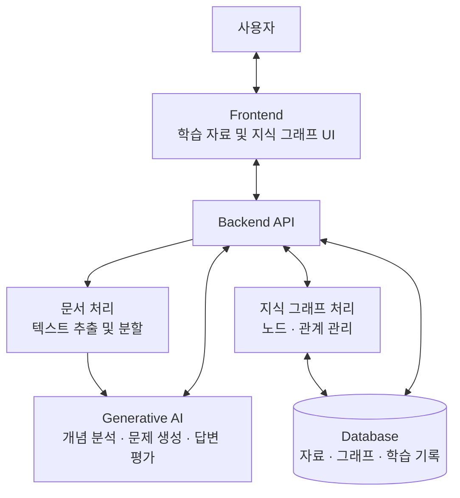
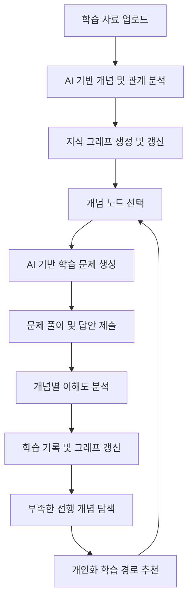

# LearnMap

**생성형 AI 기반 개인화 학습 지식 그래프 시스템**

LearnMap은 PDF, PPT, 강의노트 등 다양한 학습 자료를 분석하여 핵심 개념과 개념 간 관계를 지식 그래프(Knowledge Graph) 형태로 시각화하고, 사용자의 학습 기록과 이해도를 바탕으로 개인화된 학습 경로를 제공하는 AI 기반 학습 지원 서비스입니다.

단순히 학습 자료를 요약하는 데 그치지 않고, **무엇을 학습해야 하는지, 각 개념이 어떻게 연결되는지, 어떤 개념에 대한 이해가 부족한지**를 지속적으로 파악할 수 있는 학습 환경을 구축하는 것을 목표로 합니다.

> **프로젝트 상태:** 개발 진행 중  
> **개발 기간:** 2026.10 ~ 2026.11  
> **최종 발표:** 2026.11.17

---

## 1. 프로젝트 배경

### 1.1 문제 정의

일반적인 학습 환경에서는 강의 자료, 교재, 개인 필기 등 여러 학습 자료가 서로 다른 형태로 분산되어 있습니다. 학습자는 각각의 자료를 통해 개별 개념을 습득할 수 있지만, 전체 과목의 개념 구조와 개념 간 관계를 파악하기 위해서는 별도의 정리 과정이 필요합니다.

특히 학습 자료가 누적될수록 다음과 같은 문제가 발생합니다.

- **학습 자료의 분산:** 여러 문서에 포함된 개념을 통합하여 관리하기 어려움
- **개념 간 관계 파악의 어려움:** 각 개념의 상위·하위·연관·선행 관계를 직접 정리해야 함
- **학습 상태의 불명확성:** 학습한 개념과 이해가 부족한 개념을 객관적으로 구분하기 어려움
- **복습 우선순위 결정의 어려움:** 특정 개념을 이해하지 못했을 때 어떤 기초 개념부터 복습해야 하는지 파악하기 어려움
- **학습 기록의 연속성 부족:** 시간이 지나거나 새로운 자료가 추가될 때 기존 학습 상태와 연결하여 관리하기 어려움

기존의 생성형 AI 서비스는 문서 요약, 개념 설명, 질의응답 등의 기능을 제공하지만, 여러 학습 자료에서 추출한 개념을 하나의 지식 그래프로 구성하고 사용자별 학습 상태를 지속적으로 반영하는 데에는 별도의 시스템이 필요합니다.

### 1.2 해결 방안

LearnMap은 학습 자료와 사용자의 학습 기록을 **지속적으로 갱신되는 지식 그래프**로 통합합니다.

사용자가 새로운 학습 자료를 업로드하면 생성형 AI가 핵심 개념과 개념 간 관계를 추출하고, 이를 기존 지식 그래프에 반영합니다.

또한 각 개념에 대한 문제를 생성하고 사용자의 답변을 분석하여 이해도를 평가합니다. 이를 통해 이해가 부족한 개념뿐 아니라 해당 개념을 학습하기 위해 먼저 이해해야 하는 선행 개념까지 추적하고, 개인화된 학습 순서를 추천합니다.

---

## 2. 프로젝트 목표

LearnMap의 주요 목표는 다음과 같습니다.

1. **학습 자료의 통합 및 구조화**
   - 여러 학습 자료에서 핵심 개념을 추출하고 중복 개념을 통합합니다.
   - 개념 간 의미적 관계를 분석하여 체계적인 지식 구조를 생성합니다.

2. **지식 그래프 기반 시각화**
   - 개념을 노드(Node), 개념 간 관계를 엣지(Edge)로 표현합니다.
   - 전체 과목의 학습 구조를 직관적으로 탐색할 수 있도록 합니다.

3. **개념별 이해도 분석**
   - AI가 생성한 문제와 사용자의 답변을 바탕으로 개념별 이해도를 평가합니다.
   - 평가 결과와 학습 기록을 누적하여 지속적으로 갱신합니다.

4. **개인화된 학습 지원**
   - 이해도가 낮은 개념과 연결된 선행 개념을 추적합니다.
   - 학습자의 이해도, 오답 기록 및 학습 목표를 고려하여 학습 순서를 추천합니다.

---

## 3. 주요 기능

### 3.1 학습 자료 통합 및 지식 그래프 생성

사용자는 PDF, PPT, 강의노트 등의 학습 자료를 업로드할 수 있습니다.

시스템은 업로드된 자료를 분석하여 핵심 개념을 추출하고, 개념 간 관계를 구조화합니다.

**주요 기능**

- PDF, PPT 및 텍스트 기반 학습 자료 업로드
- 문서 내 핵심 개념 추출
- 동일하거나 유사한 개념의 중복 탐지 및 통합
- 개념 간 상위·하위·연관·선행 관계 분석
- 새로운 학습 자료 업로드 시 기존 지식 그래프 갱신
- 개념별 원본 학습 자료 연결

**처리 흐름**

```text
학습 자료 업로드
        ↓
문서 텍스트 추출
        ↓
AI 기반 핵심 개념 분석
        ↓
중복 개념 탐지 및 통합
        ↓
개념 간 관계 분석
        ↓
기존 그래프와 병합
        ↓
통합 지식 그래프 생성
```

### 3.2 지식 그래프 시각화 및 탐색

분석된 개념을 인터랙티브 그래프 형태로 시각화합니다.

사용자는 그래프를 확대·축소하거나 개념 노드를 선택하여 개념 간 관계를 확인할 수 있습니다.

**주요 기능**

- 개념 노드 및 관계 엣지 시각화
- 그래프 확대·축소 및 이동
- 개념 노드 선택 및 상세 정보 조회
- 상위·하위·연관·선행 개념 탐색
- 개념별 관련 학습 자료 조회
- 사용자 이해도에 따른 노드 상태 구분

**개념 노드의 주요 정보**

| 항목 | 설명 |
|---|---|
| 개념명 | 해당 노드가 나타내는 학습 개념 |
| 개념 설명 | AI가 학습 자료를 기반으로 정리한 개념 설명 |
| 관련 학습 자료 | 해당 개념이 등장하는 원본 자료 |
| 선행 개념 | 현재 개념을 이해하기 위해 먼저 알아야 하는 개념 |
| 연관 개념 | 의미적으로 연결된 다른 개념 |
| 이해도 | 사용자의 현재 개념별 학습 상태 |

**이해도 표시 예시**

| 상태 | 표시 | 설명 |
|---|---|---|
| 이해 | 🟢 | 개념에 대한 이해도가 충분한 상태 |
| 복습 필요 | 🟡 | 일부 이해가 부족하여 복습이 필요한 상태 |
| 이해 부족 | 🔴 | 핵심 개념에 대한 이해가 부족한 상태 |
| 미학습 | ⚪ | 아직 학습 또는 평가가 이루어지지 않은 상태 |

### 3.3 AI 기반 문제 생성 및 이해도 평가

사용자는 지식 그래프에서 특정 개념을 선택하고 해당 개념에 관한 문제를 풀 수 있습니다.

시스템은 선택된 개념 및 원본 학습 자료를 기반으로 문제를 생성하며, 사용자의 답변을 분석하여 이해도를 평가합니다.

**주요 기능**

- 개념별 학습 문제 자동 생성
- 객관식, 단답형 및 서술형 문제 제공
- 사용자 답변 분석 및 평가
- 개념 이해 수준에 대한 피드백 제공
- 개념별 이해도 갱신
- 사용자별 문제 풀이 및 평가 기록 저장

단순한 정답 여부뿐 아니라 답변에서 확인되는 개념 이해 수준을 분석하여 해당 개념의 학습 상태에 반영하는 것을 목표로 합니다.

**처리 흐름**

```text
개념 노드 선택
        ↓
관련 학습 자료 조회
        ↓
AI 기반 문제 생성
        ↓
사용자 답변 제출
        ↓
정답 및 이해 수준 분석
        ↓
개념별 이해도 갱신
        ↓
지식 그래프 상태 반영
```

### 3.4 이해 부족 원인 추적 및 개인화 학습 경로 추천

사용자가 특정 개념을 반복적으로 틀리거나 낮은 이해도를 보이는 경우, 시스템은 해당 개념과 연결된 선행 개념을 탐색합니다.

이를 통해 현재 개념 자체의 이해 부족인지, 이전 단계의 기초 개념에 대한 이해 부족이 영향을 미쳤을 가능성이 있는지 분석합니다.

**주요 기능**

- 이해도가 낮은 개념 탐지
- 선행 개념 관계 추적
- 누적 오답 및 학습 기록 분석
- 이해 부족의 원인이 될 수 있는 개념 추론
- 개념별 학습 우선순위 결정
- 사용자별 학습 경로 생성 및 시각화

**예시**

```text
주소 공간
    ↓
  페이징
    ↓
페이지 테이블
    ↓
페이지 폴트
```

사용자가 `페이지 폴트(Page Fault)`를 반복적으로 틀리는 경우, 해당 개념의 선행 개념인 `페이지 테이블(Page Table)`이나 `페이징(Paging)`의 이해도를 함께 확인합니다.

기초 개념에 대한 이해 부족이 확인된다면 해당 개념을 우선 복습하도록 학습 순서를 추천합니다.

이 과정에서 AI가 추론한 이해 부족 원인은 확정적인 진단이 아닌 **학습 기록과 개념 관계를 바탕으로 도출한 원인 후보**로 제공합니다.

---

## 4. 시스템 구조

LearnMap은 프론트엔드, 백엔드, 생성형 AI 처리 계층, 데이터베이스로 구성됩니다.

### 4.1 시스템 아키텍처



### 4.2 구성 요소별 역할

| 구성 요소 | 역할 |
|---|---|
| Frontend | 자료 업로드, 지식 그래프 시각화, 문제 풀이 및 학습 경로 조회 |
| Backend | API 요청 처리, AI 호출 관리, 문서 처리 및 데이터 관리 |
| Generative AI | 핵심 개념 추출, 개념 관계 추론, 문제 생성, 답변 평가, 학습 경로 생성 |
| Database | 사용자 정보, 학습 자료, 그래프 노드 및 엣지, 문제 풀이 기록, 이해도 저장 |

### 4.3 지식 그래프 데이터 구조

지식 그래프는 크게 **개념 노드(Node)**와 **관계 엣지(Edge)**로 구성합니다.

**Node**

하나의 학습 개념을 나타내며 개념명, 설명, 관련 학습 자료 등의 정보를 포함합니다.

**Edge**

두 개념 사이의 연결 관계를 나타내며 상위·하위, 연관, 선행 관계 등의 유형을 포함합니다.

**Learning State**

사용자마다 개별적으로 관리되는 학습 상태입니다. 개념별 이해도와 평가 이력을 관리하고 추천 학습 경로 생성에 활용합니다.

개념의 구조와 사용자별 학습 상태를 분리하여 같은 지식 그래프를 활용하더라도 사용자마다 서로 다른 이해도와 학습 경로를 가질 수 있도록 설계합니다.

---

## 5. 생성형 AI 활용

LearnMap에서 생성형 AI는 단순한 문서 요약 도구가 아니라 학습 자료를 구조화하고, 학습자의 현재 상태를 분석하며, 개인화된 학습을 지원하는 핵심 처리 요소입니다.

| 활용 영역 | 입력 | AI 처리 | 출력 |
|---|---|---|---|
| 핵심 개념 추출 | 학습 자료 | 주요 학습 개념 및 설명 분석 | 개념 목록 |
| 개념 관계 추론 | 추출 개념 및 문서 내용 | 개념 간 관계와 선행 관계 분석 | 지식 그래프 관계 정보 |
| 문제 생성 | 선택 개념 및 원본 자료 | 개념별 평가 문항 구성 | 학습 문제 |
| 답변 평가 | 문제, 답변, 학습 자료 | 정답 여부 및 이해 수준 분석 | 평가 결과 및 피드백 |
| 학습 경로 추천 | 지식 그래프, 이해도, 학습 이력 | 부족한 선행 개념 분석 및 우선순위 추론 | 개인화 학습 경로 |

### AI 생성 결과의 신뢰성

생성형 AI가 개념 간 관계를 잘못 추론하거나 답변을 부정확하게 평가할 가능성을 고려하여 다음과 같은 방향으로 시스템을 설계합니다.

- **원본 자료 기반 분석:** 개념 추출과 문제 생성은 업로드된 학습 자료를 기준으로 수행
- **구조화된 출력:** AI의 분석 결과를 일정한 데이터 형식으로 변환하여 저장
- **관계 검증:** 중복 관계, 순환 선행 관계 및 비정상적인 그래프 구조 검사
- **평가 기준 관리:** 정답과 핵심 평가 요소를 기준으로 답변 분석
- **학습 이력 활용:** 단일 답변보다 누적 기록을 고려하여 이해도 갱신
- **불확실성 구분:** 이해 부족 원인 분석 결과를 확정적인 사실이 아닌 추론 결과로 제시

---

## 6. UI/UX 설계

LearnMap은 마인드맵 형태의 지식 그래프를 중심으로 사용자가 학습 구조를 직관적으로 이해할 수 있는 인터페이스를 지향합니다.

### 6.1 지식 그래프 화면

- 과목 및 학습 자료 탐색
- 핵심 개념 및 연결 관계 시각화
- 개념별 이해도 상태 구분
- 노드 선택 시 상세 정보 표시
- 관련 자료 및 문제 풀이 기능 연결

### 6.2 문제 풀이 화면

- 현재 평가 중인 개념 표시
- 문제 내용 및 진행률 확인
- 객관식·단답형·서술형 답변 입력
- 답안 제출 및 평가 결과 확인
- 관련 학습 자료 및 선행 개념 조회

### 6.3 개인화 학습 경로 화면

- 현재 이해도가 부족한 개념 확인
- 추천 학습 순서 시각화
- 추천 이유 및 선행 개념 관계 확인
- 학습 진행 상황 관리

**[Figma UI/UX 디자인 확인](https://www.figma.com/design/RaU0AGaqtBoOIf1X6GcEdM)**

---

## 7. 기존 서비스와의 차별점

일반적인 AI 기반 학습 지원 서비스가 문서별 요약이나 질의응답을 중심으로 작동한다면, LearnMap은 **학습 자료, 개념 관계, 사용자별 학습 기록을 하나의 지속적인 학습 구조로 연결하는 것**을 핵심으로 합니다.

| 비교 항목 | 일반적인 대화형 AI 활용 | LearnMap |
|---|---|---|
| 학습 자료 처리 | 개별 문서 요약 및 질의응답 중심 | 여러 자료의 개념 구조 통합 |
| 개념 관계 표현 | 텍스트 설명 또는 일회성 다이어그램 | 지속적으로 관리되는 지식 그래프 |
| 학습 기록 | 대화 또는 별도 기록 중심 | 개념별 이해도 및 평가 이력 저장 |
| 이해 부족 분석 | 질문에 따른 개념 설명 | 선행 개념 관계를 활용한 부족 개념 분석 |
| 학습 경로 | 요청에 따른 학습 순서 제안 | 현재 이해도를 반영한 개인화 경로 생성 |
| 지속성 | 대화 및 사용 환경에 따라 상이 | 신규 자료와 학습 상태를 기존 그래프에 누적 |

LearnMap의 핵심 차별점은 새로운 AI 모델 자체보다는 **생성형 AI와 지속적으로 갱신되는 지식 그래프, 학습 이력 데이터를 결합한 학습 경험**에 있습니다.

---

## 8. 사용자 이용 흐름



이러한 반복적인 학습 과정을 통해 사용자의 이해도가 지속적으로 갱신되고, 학습 경로도 현재 상태에 맞게 변화하도록 구성합니다.

---

## 9. 개발 일정

| 기간 | 개발 단계 | 주요 작업 |
|---|---|---|
| 10월 1주차 | 기획 및 설계 | 요구사항 확정, UI 및 데이터 구조 설계 |
| 10월 2~3주차 | 핵심 기능 구현 | 문서 처리, 개념 추출 및 지식 그래프 생성 |
| 10월 4주차 | 학습 기능 구현 | 문제 생성, 답변 평가 및 이해도 관리 |
| 10월 5주차 ~ 11월 1주차 | 개인화 기능 구현 | 부족한 선행 개념 추적 및 학습 경로 추천 |
| 11월 2주차 | 통합 및 테스트 | 기능 연동, UI/UX 개선 및 오류 수정 |
| 11월 16일 | 최종 준비 | 최종 테스트, 배포 및 시연 준비 |
| **11월 17일** | **최종 발표** | **프로젝트 발표 및 시연** |

---

## 10. 기대 효과

### 체계적인 학습 자료 관리

분산된 학습 자료의 핵심 개념을 하나의 지식 그래프로 통합하여 과목 전체의 학습 구조를 쉽게 파악할 수 있습니다.

### 학습 상태의 시각화

사용자는 자신이 이해한 개념과 이해가 부족한 개념을 시각적으로 확인할 수 있어 학습 진행 상황을 보다 명확하게 파악할 수 있습니다.

### 효율적인 복습

이해도가 낮은 개념의 선행 관계를 분석하여 복습이 필요한 기초 개념을 우선적으로 확인할 수 있습니다.

### 개인화된 학습 경험

사용자별 문제 풀이 기록과 이해도를 바탕으로 서로 다른 학습 경로를 추천함으로써 개인의 학습 상태에 맞는 학습을 지원합니다.

### 지속적인 학습 관리

새로운 학습 자료와 학습 결과가 누적될 때마다 지식 그래프와 이해도가 갱신되어 장기간의 학습 과정을 일관되게 관리할 수 있습니다.

---

## 11. 프로젝트 자료

- **[UI/UX 디자인 — Figma](https://www.figma.com/design/RaU0AGaqtBoOIf1X6GcEdM)**
- **[프로젝트 명세 — Notion](https://app.notion.com/p/3eacf77e35a7803f90e7e147637108e3)**

---

## 12. 향후 확장 방향

핵심 기능 구현 이후에는 다음과 같은 확장을 고려할 수 있습니다.

- 사용자별 개념 이해도의 시간에 따른 변화 시각화
- 개념별 학습 난이도 및 문제 수준 자동 조절
- 복습 주기 추천 및 학습 일정 관리
- 여러 과목 간 공통 개념 연결
- 학습자의 피드백을 통한 개념 관계 수정 및 지식 그래프 개선
- 학습 목표에 따른 지식 그래프 필터링 및 맞춤형 학습 계획 제공

---

**LearnMap — 학습 자료를 지식으로 연결하고, 이해도를 학습 경로로 확장하다.**
